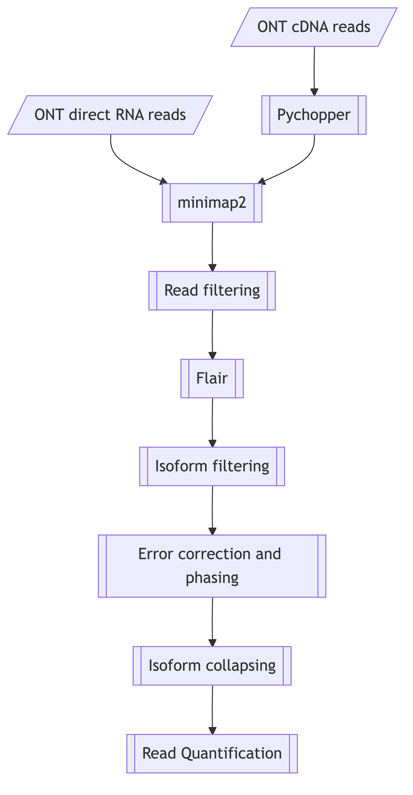

# KLK4 transcript isoform analysis (Oxford Nanopore direct RNA and cDNA)

Analysis code and final isoform models accompanying the manuscript

> **Identification of new KLK4 transcript variants and characterization of polysome-associated isoforms**
> Martin Pippel, Olivia Carlund, Pernilla Wikström, Maria Brattsand
> (in preparation)

This repository documents how the KLK4 (kallikrein-related peptidase 4) transcript isoforms
were reconstructed from long-read RNA sequencing of the prostate cancer cell lines 22Rv1 and
C4-2B (±10 nM DHT; whole-cell lysate and polysome fractions). It covers manuscript section
2.7 (*Data analysis*) and the figures and tables listed under
[Manuscript figures and tables](#manuscript-figures-and-tables).

The analysis was performed as a support project of the [National Bioinformatics
Infrastructure Sweden (NBIS)](https://nbis.se).

## Overview



1. **Reference.** Apply the 75 bp insertion and 8 bp deletion in KLK4 exon 6 that the RNA
   reads support to chr19. Move the KLK gene annotation onto the modified chr19.
2. **Reads.** Pychopper for cDNA. Genome alignment with minimap2, and selection of the
   reads overlapping KLK4.
3. **FLAIR.** align → correct (annotated vs. novel splice sites) → collapse → filter →
   quantify.
4. **Curation per model.** Splice-junction QC of every supporting read, read-based
   polishing with racon, and SNV phasing with freebayes, WhatsHap and bcftools.
5. **Final models.** Merge, re-quantify, alignment-based read counting, and
   haplotype-resolved counts.
6. **Figures.** Isoform structures and per-sample usage (Figs. 6, 7 and S1).

Result: **30 KLK4 isoform models from dRNA and 37 from cDNA**, including KLK4T2-type
KLK4–KLKP1 fusion transcripts. No transcript covers the exons that encode the signal
peptide.

The full step-by-step description, with parameters and intermediate numbers, is in
**[docs/workflow.md](docs/workflow.md)**.

## Manuscript figures and tables

| manuscript | content | source in this repository |
|---|---|---|
| Fig. 5 | analysis workflow | [docs/img/workflow.mmd](docs/img/workflow.mmd) (PNG/SVG next to it) |
| Fig. 6A/B | 10 most abundant dRNA models: KLK4 structures / usage per sample | `results/KLK4/dRNA/all-top10/`, `scripts/10_plot_isoforms.sh` |
| Fig. 6C/D | as A/B, KLK4T2-like fusion models | `results/KLK4T2/dRNA/all-top10/` |
| Fig. 7A–D | as Fig. 6, cDNA | `results/KLK4/cDNA/all-top10/`, `results/KLK4T2/cDNA/all-top10/` |
| Fig. S1A–D | all final models: dRNA KLK4, dRNA fusions, cDNA KLK4, cDNA fusions | `results/KLK4/*/all/`, `results/KLK4T2/*/all/` (`*_isoforms.png` of step 10) |
| Table 1 | samples | [config/samples.tsv](config/samples.tsv) |
| Table 2 | read counts per sample of the 10 most abundant models of each method | `results/KLK4/*/all-top10/`, `results/KLK4T2/*/all-top10/` (`*.counts*.tsv`) |
| Table 3 | dRNA vs cDNA models (matched by exon structure) | `results/KLK4/comp_dRNA_cDNA/`, `results/KLK4T2/comp_dRNA_cDNA/` |
| Table 4 | read support of the 10 most abundant KLK4 and KLK3 models (dRNA) | `results/KLK4/dRNA/all-top10/`, `results/KLK3/dRNA/` |
| Table S1 | putative KLK4 peptides | translated from the dRNA models in `results/KLK4*/dRNA/all/fasta_models/` |
| Table S2 | complete list of KLK4 and KLK4T2-like models | `results/KLK4*/*/all/`, `results/*/comp_dRNA_cDNA/` |

In the figures, models with a premature termination codon (ORF tag `PTC`, see
[docs/isoform_naming.md](docs/isoform_naming.md)) are drawn hatched.

## Repository layout

```
.
├── README.md
├── environment.yml              conda environment (software and versions)
├── CITATION.cff
├── config/
│   ├── samples.tsv              8 samples, FASTQ names, basecaller versions
│   ├── gene_regions.tsv         regions used to select gene reads
│   ├── dRNA_KLK4_step06_polishing_parameters.tsv   per-model parameters (step 07), dRNA
│   ├── cDNA_KLK4_step06_polishing_parameters.tsv   per-model parameters (step 07), cDNA
│   ├── dRNA_KLK4_step08_final_models.tsv           30 final dRNA models and their final names
│   ├── cDNA_KLK4_step08_final_models.tsv           37 final cDNA models and their final names
│   └── dRNA_KLK4_step09_phased_models.tsv          12 phased dRNA models (step 09)
├── scripts/
│   ├── config.sh                paths and settings shared by all steps
│   ├── basecalling_dorado.sh    basecalling, demultiplexing, Q10 filter
│   ├── 00_prepare_reference.sh
│   ├── 01_lift_annotation_to_modified_reference.sh
│   ├── 02_preprocess_cDNA_pychopper.sh
│   ├── 03_align_genome_and_subset_gene_reads.sh
│   ├── 04_flair_align_correct_collapse.sh
│   ├── 05_filter_isoforms.sh
│   ├── 06_quantify_isoforms.sh
│   ├── 07_qc_polish_phase_isoforms.sh
│   ├── 08_merge_and_validate_final_models.sh
│   ├── 09_phase_aware_read_counts.sh
│   ├── 10_plot_isoforms.sh
│   ├── bin/                     helper scripts called by the steps
│   │   ├── modify_reference.py         step 00: exon-6 insertion/deletion
│   │   ├── filter_isoforms_by_region.sh
│   │   ├── filter_isoforms_by_exon_size.sh
│   │   ├── match_splice_sites.py       read vs. model splice-junction QC
│   │   ├── rank_and_rename_models.py   step 06: rank and name models
│   │   ├── plot_isoform_usage.py       modified FLAIR plot_isoform_usage
│   │   └── colorPalettes/
├── ref/                         small reference files (KLK4/KLK4T2 annotation, KLK4T2 cDNA)
├── docs/
│   ├── workflow.md              detailed methods
│   ├── isoform_naming.md        im*/dim*/cim* names, ORF tags, sample names
│   ├── KLK4_dRNA_final_models.tsv     structure of the 30 final dRNA models
│   └── img/                     workflow diagram (Mermaid source, PNG, SVG)
└── results/                     final models (BED12, FASTA) and read counts
```

## How to use this repository

Each step can be run with the numbered scripts. Model curation in steps 07–08 involved
inspection in IGV and the selection of template reads. The resulting parameters are
recorded in `config/` and read by the scripts.

```bash
# 1. software
conda env create -f environment.yml
conda activate klk4-isoforms

# 2. adapt paths in scripts/config.sh (WORKDIR, READDIR, THREADS) and place
#    GRCh38.p14.primary_assembly.genome.fa + the GENCODE GTF in ${WORKDIR}/ref/

# 3. run the steps for one read type and gene
export TYPE=dRNA GENE=KLK4
bash scripts/00_prepare_reference.sh
bash scripts/01_lift_annotation_to_modified_reference.sh
bash scripts/03_align_genome_and_subset_gene_reads.sh     # TYPE=cDNA: run step 02 first
bash scripts/04_flair_align_correct_collapse.sh
bash scripts/05_filter_isoforms.sh
bash scripts/06_quantify_isoforms.sh
bash scripts/07_qc_polish_phase_isoforms.sh remap corrected
bash scripts/07_qc_polish_phase_isoforms.sh remap inconsistent
bash scripts/07_qc_polish_phase_isoforms.sh candidates corrected <model> <n_exons>   # choose template reads
bash scripts/07_qc_polish_phase_isoforms.sh all                                       # uses config/*step06*.tsv
bash scripts/08_merge_and_validate_final_models.sh
bash scripts/09_phase_aware_read_counts.sh                 # dRNA only

# Figs. 6, 7 and S1 can be redrawn directly from results/ (needs only matplotlib/seaborn):
bash scripts/10_plot_isoforms.sh figures/
```

## Software

| tool | version | used in step |
|---|---|---|
| dorado | 0.7.1 (batch 1), 0.9.0 (cDNA batch 2), 0.9.1 (dRNA batch 2); models: `dna_r10.4.1_e8.2_400bps_sup@v5.0.0` (cDNA), `rna004_130bps_sup@v5.0.0` (dRNA batch 1), `rna004_130bps_sup@v5.1.0` (dRNA batch 2) | basecalling (`scripts/basecalling_dorado.sh`) |
| Pychopper | 2.7.10 | 02 |
| minimap2 | 2.30-r1287 | 01, 03, 04, 07–09 |
| samtools | 1.22.1 | all |
| seqkit | 2.4.0 | 03–09 |
| bedtools | 2.31.1 | 01, 05 |
| UCSC bedToGenePred / genePredToGtf | 482 (bioconda build h0b57e2e_0) | 01 |
| gffread | 0.12.7 | 01 |
| FLAIR | 2.2.0 (development version) | 04–08 |
| racon | 1.5.0 | 07 |
| freebayes | 1.3.10 | 07, 09 |
| vcflib (vcffilter) | 1.0.14 | 07, 09 |
| WhatsHap | 2.8 | 07 |
| bcftools | 1.22 | 07, 09 |
| Python | 3.12.11 | 00, 07, 08, 10 |
| pysam | 0.22.1 | 07, 08 |
| numpy | 2.3.2 | 10 |
| matplotlib, seaborn | 3.11.2, 0.13.2 | 10 |

## Data availability

* Nanopore direct RNA and cDNA reads: ENA/SRA accession *[to be added]*
* Whole-genome sequencing of C4-2B: accession *[to be added]*
* Reference: GENCODE release 46 (GRCh38.p14): primary assembly and comprehensive gene annotation

## Citation

If you use this code or the isoform models, please cite the manuscript above (see
[CITATION.cff](CITATION.cff)).

## Acknowledgements

Computations were performed on resources provided by the National Academic Infrastructure
for Supercomputing in Sweden (NAISS) at UPPMAX, projects NAISS 2024/22-546 and
NAISS 2024/22-1471 (extension). Sequencing was performed at the NGI Uppsala Genome Center
(SciLifeLab).

## License

This project is licensed under the [MIT License](LICENSE).

## Contact

Martin Pippel (NBIS), martin.pippel@nbis.se · Olivia Carlund (Umeå University),
olivia.carlund@umu.se · Maria Brattsand (corresponding author), maria.brattsand@umu.se
