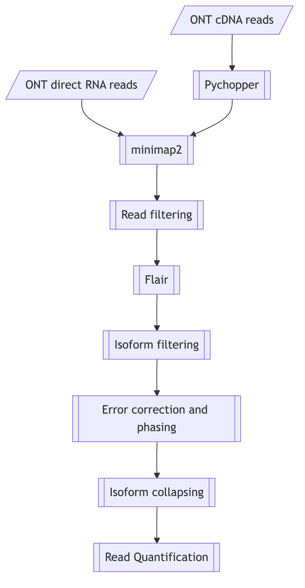

# KLK4 isoform analysis — detailed workflow

This document describes step by step how the KLK4 transcript isoforms reported in the
manuscript (Figs. 5–7 and S1, Tables 2–4 and S2) were derived from Oxford Nanopore direct RNA (dRNA) and
PCR-cDNA reads. Each step names the script that implements it.

*Fig. 5 of the manuscript (source: [img/workflow.mmd](img/workflow.mmd)).*

---

## Input data

| | direct RNA | cDNA |
|---|---|---|
| Library kit | SQK-RNA004 | SQK-PCB114.24 (modified PCR: 14 cycles, 10 min extension) |
| Flow cell | FLO-PRO004RA (PromethION), 1 library/flow cell | FLO-PRO114M, 2 libraries/flow cell |
| Basecalling | dorado 0.9.1, `sup@v5.1.0,m5C,m6A_DRACH,pseU` (batch 1: dorado 0.7.1, `sup,m6A,pseU`) | dorado 0.9.0, `sup`, `--no-trim` (batch 1: dorado 0.7.1) |
| Model | `rna004_130bps_sup@v5.1.0` (batch 1: `@v5.0.0`) | `dna_r10.4.1_e8.2_400bps_sup@v5.0.0` |
| Demultiplexing | – | `dorado demux --no-trim --kit-name SQK-PCB114-24` |
| Read filter | mean Q ≥ 10 | mean Q ≥ 10 |

Basecalling commands: [scripts/basecalling_dorado.sh](../scripts/basecalling_dorado.sh). All
runs used `--estimate-poly-a`. cDNA reads were basecalled and demultiplexed without
trimming, because Pychopper needs the primers to orient the reads.

The eight samples are two cell lines (22Rv1 = `22`, C4-2B = `C4`), each treated with 0 or
10 nM DHT, each as pooled polysome fractions (no suffix) or whole-cell lysate (suffix `W`).
See [config/samples.tsv](../config/samples.tsv).

---

## Step 00 – Modified reference  (`scripts/00_prepare_reference.sh`)

Almost all KLK4 reads show two differences to GRCh38 in **exon 6**:

1. a **75 bp insertion** after chr19:50,906,558
   `GTCTGAGGGAGGAGGGGTTGGGGGCCTGGACCCCTGGGTCTGAGGGAGGAGGGGCTGGGGGATCTGGACTCCTGG`
   (sporadically 104, 114 or 196 bp long tandem-repeat-like variants),
2. an **8 bp deletion** of chr19:50,906,576–50,906,583 (`TTGGGGGC`).

chr19 is extracted from GENCODE release 46 (GRCh38.p14) and both edits are applied
(`scripts/bin/modify_reference.py`). This gives `chr19-cleaned-mod2.fa` (58,617,683 bp). All
coordinates downstream of 50,906,558 shift by +67 bp.

## Step 01 – Annotation on the modified reference  (`scripts/01_lift_annotation_to_modified_reference.sh`)

Transcripts of 15 KLK genes (KLK2–KLK15, KLKP1) from the GENCODE annotation and the KLK4T2
fusion transcript (Lundwall et al. 2021) are extracted as sequences. They are re-aligned to
the modified chr19 with `minimap2 -ax splice:hq` and converted back to GTF (bedtools →
bedToGenePred → genePredToGtf). The merged file
`chr19-cleaned-mod2-allKLKs_transcripts.fix.gtf` is the annotation used by FLAIR.

## Step 02 – cDNA preprocessing  (`scripts/02_preprocess_cDNA_pychopper.sh`)

Pychopper (`-k PCB114 -m phmm`) identifies, trims and orients full-length cDNA reads (> 94 %
of reads in every sample). Direct RNA reads need no preprocessing.

## Step 03 – Genome alignment and gene read selection  (`scripts/03_align_genome_and_subset_gene_reads.sh`)

All reads are aligned to GRCh38.p14 with
`minimap2 -ax splice -ub -k14 -w 4 -y --junc-bed junctions.bed --secondary=no`. Primary
alignments overlapping the gene region
([config/gene_regions.tsv](../config/gene_regions.tsv); KLK4: chr19:50,905,245–50,911,955)
are extracted with `samtools view -F 3844`. Reads are named `<type>-<sample>-<n>`.

## Step 04 – FLAIR align / correct / collapse  (`scripts/04_flair_align_correct_collapse.sh`)

The reads of all eight samples are pooled.

| sub-step | key options | result (dRNA KLK4) |
|---|---|---|
| `flair align` | `--nvrna --quality 20 --remove_singleexon --filtertype separate` | 14,509 of 17,780 reads kept (268 chimeric, 409 MAPQ < 20, 2,594 single-exon) |
| `flair correct` | `--nvrna` + annotation | 6,926 **corrected** (annotated junctions) / 7,583 **inconsistent** (novel junctions) |
| `flair collapse` (each set separately) | `--stringent --check_splice --generate_map` (+ `--annotation_reliant generate` for the corrected set) | isoform models of set **a** (corrected) and **b** (inconsistent) |

`--stringent`: every supporting read covers ≥ 80 % of the model and ≥ 25 bp of its first and
last exon. `--check_splice`: 4 of 6 bp around each splice site match, and there is no
insertion > 3 bp at the site.

## Step 05 – Model filtering  (`scripts/05_filter_isoforms.sh`)

Models without any exon in the KLK4 region, and models with an exon < 25 bp, are removed
(`scripts/bin/filter_isoforms_by_region.sh`, `scripts/bin/filter_isoforms_by_exon_size.sh`).

## Step 06 – FLAIR quantification  (`scripts/06_quantify_isoforms.sh`)

`flair quantify --stringent --check_splice --generate_map` gives per-sample counts and the
read-to-model assignment. The models are then ranked by total read count and renamed
`im<rank>-<set>-R<reads>-P<percent>` (`scripts/bin/rank_and_rename_models.py`, see
[isoform_naming.md](isoform_naming.md)). Set b models with < 10 reads are dropped.

Result: dRNA KLK4, 16 models in set a and 36 in set b (im1–im52); cDNA KLK4, 25 models in
set a and 69 in set b (im1–im94). The set b reads come almost exclusively from 22Rv1.

## Step 07 – QC, polishing and phasing per model  (`scripts/07_qc_polish_phase_isoforms.sh`)

For every model:

1. **QC.** The reads assigned by FLAIR are realigned. `scripts/bin/match_splice_sites.py`
   keeps only reads with exactly the model's junctions. For each read it reports soft clips,
   indels, end offsets and exon count. Models with < 10 supporting reads are discarded.
2. **Polishing.** A template read is selected. Criteria, in order: fewest indels, longest
   soft-clipped poly(A) tail, no 5′ soft clipping. All other supporting reads are aligned to it
   (`minimap2 -x map-ont`), and one round of `racon` produces the read-based model sequence.
3. **Phasing.** The reads are realigned to the polished sequence, with one read group per
   sample. SNVs are called with freebayes (QUAL > 300; > 100 or > 1 for low-support models)
   and phased with `whatshap phase`, and the reads are haplotagged.
   `bcftools consensus -H 1/2` builds one sequence per haplotype from the phased genotype of
   one sample.

The parameters for each model (template read, expected exons, QUAL threshold, phasing
sample, outcome) are listed in
[config/dRNA_KLK4_step06_polishing_parameters.tsv](../config/dRNA_KLK4_step06_polishing_parameters.tsv)
(52 models) and
[config/cDNA_KLK4_step06_polishing_parameters.tsv](../config/cDNA_KLK4_step06_polishing_parameters.tsv)
(94 models).

## Step 08 – Merge, re-quantify, validate  (`scripts/08_merge_and_validate_final_models.sh`)

1. The polished models of both sets are compared in IGV. Identical models are merged and
   near-duplicates with low read support are removed.
2. `flair quantify` is rerun on the polished (haplotype 1) sequences.
3. **Alignment-based counting.** All reads of each sample are aligned to the modified chr19.
   A read counts for a model only if it has exactly the model's junctions and the same number
   of exons, and it is soft-clipped at the 5′ end by at most 1 bp (dRNA) or 5 bp (cDNA,
   residual adapter sequence). FLAIR and alignment-based counts correlate strongly. Models
   with < 10 reads are removed.
4. The final models are named `dim<rank>-R<reads>` (dRNA, ranked by FLAIR counts) and
   `cim<rank>-R<reads>` (cDNA, ranked by alignment-based counts). They are annotated with
   `flair predictProductivity --longestORF`, and the KLK4T2-type fusion models are separated
   from the KLK4 models.

This gives **30 dRNA KLK4 models**
([config/dRNA_KLK4_step08_final_models.tsv](../config/dRNA_KLK4_step08_final_models.tsv),
structures described in [KLK4_dRNA_final_models.tsv](KLK4_dRNA_final_models.tsv)).

The cDNA data give **37 cDNA KLK4 models**
([config/cDNA_KLK4_step08_final_models.tsv](../config/cDNA_KLK4_step08_final_models.tsv)).

## Step 09 – Haplotype-resolved counts  (`scripts/09_phase_aware_read_counts.sh`)

Haplotype-resolved counts were computed for the dRNA data. For the 12 phased dRNA models, the filtered reads are aligned to haplotype 1 and SNVs are
called per sample. For each sample, the reference (hap1) and alternative (hap2) read counts
are the minimum over all SNV sites of the model
([results/KLK4/dRNA/phasing/phasing_results.v2.tsv](../results/KLK4/dRNA/phasing/phasing_results.v2.tsv)).

## Step 10 – Figures  (`scripts/10_plot_isoforms.sh`)

`scripts/bin/plot_isoform_usage.py`, a modified FLAIR `plot_isoform_usage`, draws the
model structures under the reference transcripts and the per-sample read support
(manuscript Figs. 6, 7 and S1). Figs. 6 and 7 show the 10 most abundant models of each
method (`all-top10/`), split into KLK4 (panels A/B) and KLK4T2-like fusion models (C/D).
Fig. S1 shows the structures of all final models (`all/`). Models with a premature
termination codon (`PTC`) are drawn hatched. The script runs directly on the tables in
`results/`.

## dRNA vs cDNA comparison (manuscript Table 3)

Final dRNA and cDNA models are matched by identical exon structure
(`results/KLK4/comp_dRNA_cDNA/`).
